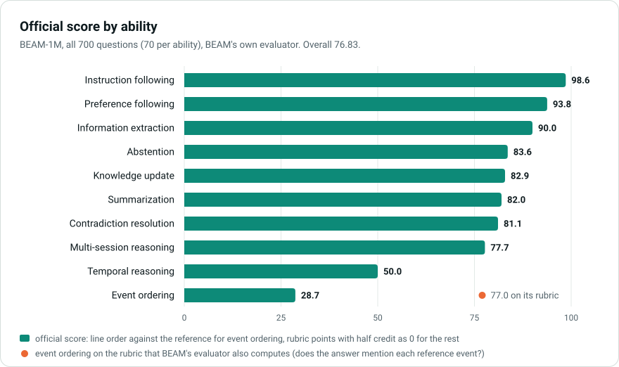

<h1 align="center">Long-term memory for AI assistants: public results</h1>

<p align="center">
Two memory benchmarks, each with every answer, every judge decision, cost and latency, and a verifier you can run in a minute.
</p>

<p align="center">
<a href="https://arnav.network/research/memory"><b>Research reports</b></a> ·
<a href="beam-1m/README.md"><b>BEAM-1M proof</b></a> ·
<a href="longmemeval-s/README.md"><b>LongMemEval-S proof</b></a> ·
<a href="https://github.com/arnavgupta00/memory-public/releases/latest">Download</a>
</p>

## Results at a glance

| Benchmark | What it tests | Questions | Score | Cost per question | Proof |
|---|---|---:|---:|---:|---|
| **BEAM, 1M-token tier** | memory over conversations of about a million tokens, ten abilities | 700 | **76.83** with BEAM's own evaluator | **$0.15** billed | [`beam-1m/`](beam-1m/README.md) |
| **LongMemEval-S** | memory over chat histories of about 115,000 tokens, six abilities plus abstention | 500 | **91.40%** (457/500) with LongMemEval's own judge | **$0.047** at list price | [`longmemeval-s/`](longmemeval-s/README.md) |

BEAM ran on our October configuration (DeepSeek V4.1 Flash). LongMemEval ran on the July version it grew from
(gpt-5.6-luna and gpt-5.4-nano).

## Check it yourself in one minute

```bash
git clone https://github.com/arnavgupta00/memory-public && cd memory-public
python3 beam-1m/verify/verify.py --deep        # BEAM-1M: 19 checks, offline
python3 longmemeval-s/verify/verify.py         # LongMemEval-S: 9 checks, offline
```

It needs only Python 3: no network, no keys. Add `--online` to also check the data and dates against third parties, and
see [VERIFY.md](beam-1m/VERIFY.md) to re-judge every BEAM answer with BEAM's official evaluator (about $2.50 of OpenAI usage).

## Benchmarks

### BEAM, 1M-token tier
BEAM (Tavakoli et al., [arXiv:2510.27246](https://arxiv.org/abs/2510.27246)) asks 20 questions about each of 35
conversations of about a million tokens: 700 questions over ten abilities.

<p align="center"></p>

- **Strongest:** instruction following (98.6), preference following (93.8) and information extraction (90.0).
- **Weakest:** temporal reasoning (50.0) and event ordering (28.7). On event ordering the official metric checks line order
  against hidden reference labels; on BEAM's own rubric for the same answers it is 77.0.

Vendors do not publish BEAM's official score; each uses its own scoring basis, so we scored the same answers on each one.

| Basis | Our score | Published on this basis |
|---|---:|---|
| **BEAM official evaluator** (headline) | **76.83** | BEAM paper's best system (LIGHT): 33.6 |
| Vectorize / AMB scorer, Gemini 3.5 Flash Lite judge | 78.18 | Hindsight 73.9 · HydraDB 82 (self-reported) |
| Rubric average with BEAM's judge (Mem0's convention) | 82.23 | Mem0 64.1 (self-reported, Mem0's own judge) |
| Official, with BEAM's later half-credit fix | 77.39 | — |

Sources are in [COMPARISON.md](beam-1m/COMPARISON.md).

### LongMemEval-S
LongMemEval (Wu et al., ICLR 2025, [arXiv:2410.10813](https://arxiv.org/abs/2410.10813)) gives each of 500 questions a chat
history of about 115,000 tokens. The questions cover single-session facts and preferences, knowledge updates, temporal and
multi-session reasoning, and 30 questions that should be declined.

| Question type | Correct |
|---|---:|
| Single-session, assistant facts | 56/56 (100.00%) |
| Single-session, user facts | 68/70 (97.14%) |
| Knowledge update | 74/78 (94.87%) |
| Single-session, preferences | 27/30 (90.00%) |
| Multi-session reasoning | 116/133 (87.22%) |
| Temporal reasoning | 116/133 (87.22%) |
| **All 500** | **457/500 (91.40%)** |

- **Strongest:** facts from a single session (124 of 126) and knowledge updates.
- **Weakest:** multi-session and temporal reasoning, 87.22% each. 26 of the 30 questions to decline were declined.

Published results, self-reported, with differing answer models:

| System | Answer model | Score |
|---|---|---:|
| Mastra Observational Memory | gpt-5-mini | 94.87% |
| Mem0 (managed platform) | not stated | 94.4 |
| Mastra Observational Memory | gemini-3-pro-preview | 93.27% |
| **Ours, Architecture 0008** | **gpt-5.6-luna** | **91.40%** |
| Hindsight | gemini-3-pro-preview | 91.40% |
| EmergenceMem (internal configuration) | gpt-4o | 86.00% |
| Supermemory | gemini-3-pro-preview | 85.20% |
| Zep | gpt-4o | 71.20% |
| Full history in context | gpt-4o | 60.20% |

The full table, with sources, is in [`longmemeval-s/README.md`](longmemeval-s/README.md).

## Cost, speed and latency

A memory system has two kinds of latency.
- **Pre-processing** builds the memory before any question arrives. In live use, each session is noted when it ends.
- **Query time** is what a question costs once its memory exists. Retrieval builds the context from the memory, and then
  the answer is written.

| Latency, model time: median · 90th percentile | BEAM-1M (R9) | LongMemEval-S (Architecture 0008) |
|---|---|---|
| Pre-processing, per new session | 1.4 s · 2.7 s | 3.2 s · 5.4 s |
| Pre-processing, a whole history from cold | 3.8 min for a ~1M-token history, at our 4.8 requests/s limit | 8.0 s · 13.7 s for a ~115K-token history, notes in parallel |
| Query: retrieval, from memory to context | 2.5 min · 3.9 min | 17.2 s · 26.0 s |
| Query: answer | 4.1 min · 7.4 min | 4.5 s · 8.3 s |
| **Query total** | **6.6 min · 10.5 min** | **22.0 s · 33.8 s** |
| Cold start: a new history, then its first question | about 10.4 min | 31.4 s · 43.6 s |

| Cost and throughput | BEAM-1M (R9) | LongMemEval-S (Architecture 0008) |
|---|---|---|
| History per question | about 1,000,000 tokens | about 115,000 tokens |
| Context the answer step reads | 80,798 tokens median | about 4,182 tokens |
| Cost per question | **$0.15** billed ($0.26 at list price) | **$0.047** at list price |
| Whole benchmark | about $102 billed for 700 questions | $23.62 at list price for 500 |
| Wall clock | 340 questions with their 17 histories in 2 h 56 min | all 500, notes included, in 30.1 min |
| Throughput limit | 4.8 requests per second to the provider | 256 requests in flight, 1.95 M tokens per minute |

- **Details.** See [COSTS.md](beam-1m/COSTS.md) for BEAM and [`longmemeval-s/README.md`](longmemeval-s/README.md) for
  LongMemEval. The verifiers recompute every figure from the logged calls.

## What is in this repository

```
memory-public/
├── README.md                   this page
├── assets/                     figures for this page
├── beam-1m/                    BEAM-1M proof package
│   ├── README.md               start here: the result and how to check it
│   ├── CLAIMS.md, claims.json  every claimed number, with the check that tests it
│   ├── RESULTS.md              scores by ability, question type and run
│   ├── COMPARISON.md           the same answers on other scorers, with sources
│   ├── METHOD.md               how the system and the runs were set up
│   ├── COSTS.md                cost, speed and latency, step by step
│   ├── VERIFY.md               how to verify, from one minute to a full re-judge
│   ├── JOURNEY.md              how we got here, July to October
│   ├── data/
│   │   ├── answers/            all 700 answers, as the judge read them
│   │   ├── judge/              every official judge decision
│   │   ├── scores/             per-question scores
│   │   ├── questions/          the questions, the split and the data sources
│   │   ├── comparison/         scores on the other scorers
│   │   └── performance/        cost, tokens and latency per question
│   ├── runs/                   one folder per run: records and summaries
│   ├── bulk/                   full judge logs and model-call ledgers, compressed
│   ├── code/                   code hashes and the published freeze
│   ├── verify/                 the verifier and the official-judge scripts
│   ├── tools/                  the scripts that built the package
│   └── MANIFEST.sha256         sha256 of every file in the package
└── longmemeval-s/              LongMemEval-S proof package
    ├── README.md               start here: the result and how to check it
    ├── claims.json             every claimed number
    ├── data/
    │   ├── run/                the answers, judgments and report
    │   ├── judge-artifacts/    the judge's full record for each question
    │   ├── performance.json    cost, tokens and latency
    │   └── *.csv               latency per question and per session
    ├── verify/                 the verifier
    ├── tools/                  the script that built the package
    └── MANIFEST.sha256         sha256 of every file in the package
```

---

<sub>
BEAM: Tavakoli et al., arXiv:2510.27246; data and evaluator at github.com/mohammadtavakoli78/BEAM (MIT). LongMemEval: Wu et
al., ICLR 2025, arXiv:2410.10813; data and evaluator at github.com/xiaowu0162/LongMemEval (MIT). Competitor figures were
retrieved on 12–13 Oct 2026 from their public pages. This work is not affiliated with the benchmark authors or with any
vendor named here.
</sub>
