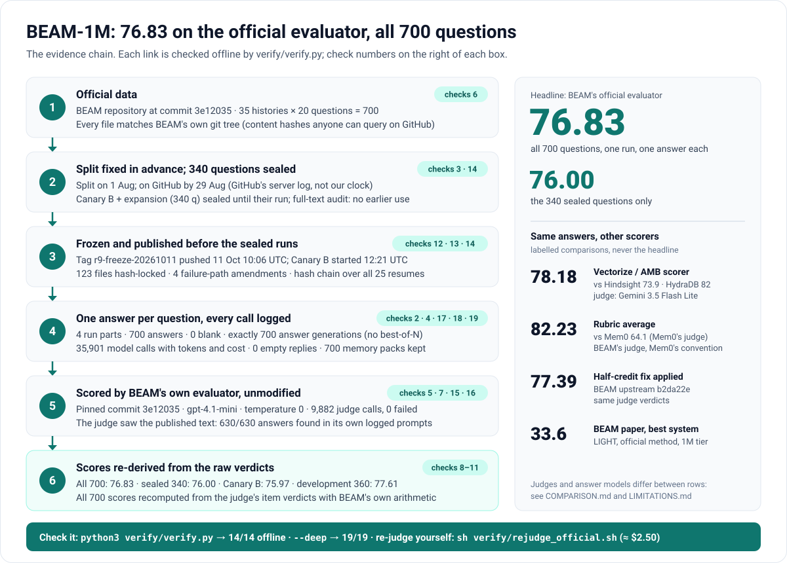

# BEAM-1M: 76.83 on the official evaluator, all 700 questions. Proof package

**The claim.** Our long-term memory system answered all 700 questions of the BEAM benchmark's 1-million-token tier. It ran
one frozen configuration and gave one answer per question. The official BEAM evaluator scored it **76.83**. On the 340
questions that were sealed until their single run, it scored **76.00**.

This public copy contains everything needed to check that claim: the hashes that tie it to BEAM's data, every answer,
every judge decision and every model call. The source code, prompts, memory packs and answer plans are withheld. Each
is committed by sha256 and can be shown to an auditor ([withheld/](withheld/README.md)).



## The numbers

| Basis | All 700 | Unseen only (340) | What it is |
|---|---:|---:|---|
| **BEAM official evaluator** | **76.83** | **76.00** | BEAM's own scorer at pinned commit `3e12035`, unmodified: gpt-4.1-mini, temperature 0. **The headline.** |
| Official, with the BEAM authors' half-credit fix | 77.39 | 76.70 | The same judge decisions, with half credit counted as BEAM upstream fixed it later (`b2da22e`) |
| Vectorize/Hindsight scorer | 78.18 | 78.00 | The method behind Hindsight's 73.9 and HydraDB's 82 (see [COMPARISON.md](COMPARISON.md)) |
| Rubric average, BEAM's judge | 82.23 | 81.74 | Mem0's convention: every ability, event ordering included, scored by rubric items |

**By part (official):**

| Part | Questions | Score |
|---|---:|---:|
| Canary A (development set) | 100 | 77.71 |
| Fresh75 histories (development set) | 260 | 77.58 |
| Canary B (sealed) | 260 | 75.97 |
| Expansion block (sealed) | 80 | 76.09 |

**By ability (official, all 700):**

| Ability | Score |
|---|---:|
| Instruction following | 98.6 |
| Preference following | 93.8 |
| Information extraction | 90.0 |
| Abstention | 83.6 |
| Knowledge update | 82.9 |
| Summarization | 82.0 |
| Contradiction resolution | 81.1 |
| Multi-session reasoning | 77.7 |
| Temporal reasoning | 50.0 |
| Event ordering | 28.7 (77.0 by rubric; see [LIMITATIONS.md](LIMITATIONS.md)) |

## Check it yourself in one minute
```
python3 verify/verify.py          # no network, no keys: integrity checks, then every number recomputed from the raw judge outputs
python3 verify/verify.py --deep   # also checks the bulk evidence: judge call logs and model-call ledgers
python3 verify/verify.py --deep --online   # also checks the Wayback Machine's copies of GitHub's records
```
Run them from this folder, after cloning the repository or unzipping the release download.

Expected output is **14/14 checks passed**, **19/19** with `--deep`, and **20/20** with `--deep --online`, which also
checks the Wayback Machine's copies of GitHub's records. The script is standard-library Python and was
tested to fail on tampered copies. Deeper checks, such as re-judging all 700 answers with the official evaluator
yourself, are in [VERIFY.md](VERIFY.md).

## Why this result can be trusted
1. **The dataset is the official one.** All 35 conversations were downloaded from BEAM's repository at commit `3e12035`.
   Every file matches the content hash in BEAM's own git tree at that commit, which anyone can check on GitHub (check 6).
2. **The split was fixed in advance.**
   - The 35 histories were split on **1 Aug 2026**, and GitHub's own server log shows the split files there by
     **29 Aug**, six weeks before the sealed runs (check 14). The Wayback Machine keeps a copy of that log (check 20).
   - One change to the plan is disclosed in full: on 24 Sep, the 13 histories reserved for a final blind check became
     development data. Canary B (260 questions) and the expansion block (80) stayed sealed.
   - A full-text search of every project record (82,322 files) found no use of a sealed history before its run
     (`data/questions/sealing-audit.json`).
3. **The system was frozen and published before the sealed runs.**
   - GitHub's server log records the push of tag commit `595a2e28` (`r9-freeze-20261011`) at 10:06 UTC on 11 Oct. Canary
     B started at 12:21 UTC.
   - The development repository is now private. The Wayback Machine's copies of the push log, the tag and the freeze-time
     hash manifest keep the dates checkable by anyone (check 20).
   - Every pipeline file is hash-locked, and every run start and resume records the code hash. The code is withheld here;
     its hashes are published.
   - Check 13 shows all 25 starts and resumes on one chain: the public freeze, then four recorded failure-path amendments
     ([AMENDMENTS.md](AMENDMENTS.md)). Nothing else changed.
4. **One answer per question.** 700 answers, none blank. The model-call ledgers contain exactly 700 answer generations,
   so no answer was picked from several (checks 2, 4 and 18).
5. **The scored text is the published text.**
   - Every answer is byte-identical to the file submitted to the judge (check 5).
   - For all 630 non-ordering questions, the published answer appears in the official judge's own logged prompts (check 16).
6. **The scores re-derive exactly.** Each of the 700 question scores is recomputed from the judge's raw rubric-item
   decisions using the evaluator's own arithmetic. Every aggregate then matches [claims.json](claims.json) (checks 8–11).
7. **Every model call is logged.** That is 35,901 model calls and 9,882 judge calls, with 0 empty replies and 0 failed judge
   calls (checks 15 and 17).
8. **The limits are stated.** Development sets, run-to-run variation, judge inconsistency, the event-ordering scorer and
   comparison caveats are all in [LIMITATIONS.md](LIMITATIONS.md).

## What is in the package
| Path | Contents |
|---|---|
| `README.md` | this page |
| `PROOF-PICTURE.svg` | the evidence chain, in one picture |
| `CLAIMS.md`, `claims.json` | every claimed number, its definition, its source file and the check that verifies it |
| `VERIFY.md` | five verification levels, from one minute offline to a full re-run |
| `METHOD.md` | the system, the models and the evaluation protocol |
| `RESULTS.md` | full tables: parts, abilities, all 35 conversations, reliability |
| `COMPARISON.md` | Hindsight, HydraDB, Mem0 and the BEAM paper: what each number means and how ours compare |
| `LIMITATIONS.md` | what this result does and does not show |
| `AMENDMENTS.md` | the four mid-run failure-path changes, with the hash chain that proves nothing else changed |
| `JOURNEY.md` | how we got here, July to October, including what failed |
| `COSTS.md` | cost, speed and latency: by provider and stage, model time per question, wall clock, tokens |
| `NOTICES.md` | licences and third-party material |
| `data/questions/` | partition and split history, the seven split files, BEAM source hashes, GitHub's push log and its Wayback Machine copies, sealing audit |
| `data/answers/` | the 700 answers (`answers.jsonl`) and the exact prediction files the judge read |
| `data/judge/` | the official evaluator's raw outputs: per-question scores, per-rubric-item verdicts and reasons |
| `data/scores/` | per-question and per-conversation score tables on every basis |
| `data/comparison/` | per-question Vectorize scores, the scripts as run, and facts from Hindsight's published results |
| `runs/<part>/` | per run: setup and rules written before the run (README or script header), question list, driver and pipeline logs, run manifest, code hashes, frozen-code check, ledger, judge-log and TypeSafe usage summaries |
| `code/` | the hash commitments for the code: `FROZEN.json` at the freeze and as run last, and the hash chain (`code-provenance.json`); the source is withheld |
| `verify/` | `verify.py`, the re-judge and Vectorize re-score helpers, and the official-judge wrapper used for the runs (its hashes match `FROZEN.json`) |
| `tools/` | the scripts that built this package from the run folders |
| `protocol/` | the split design note (protocol sections) |
| `withheld/` | what is withheld and why, with the sha256 that commits to each withheld file |
| `bulk/` | the full judge call logs, and the model-call ledgers with the prompt text removed (9 MB) |
| `MANIFEST.sha256` | sha256 of every file above |

Recommended reading order: CLAIMS → VERIFY → METHOD → RESULTS → COMPARISON → LIMITATIONS → AMENDMENTS → JOURNEY.
